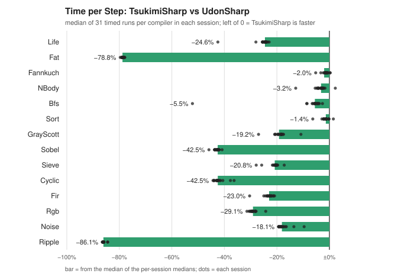
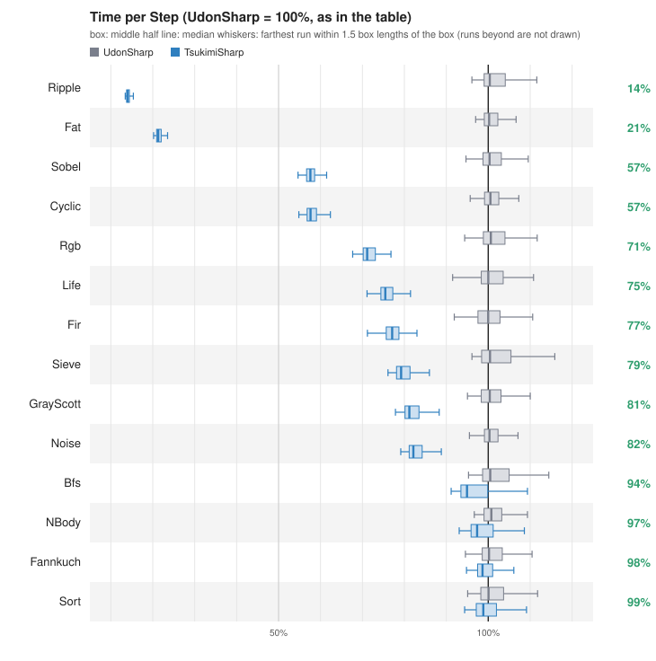
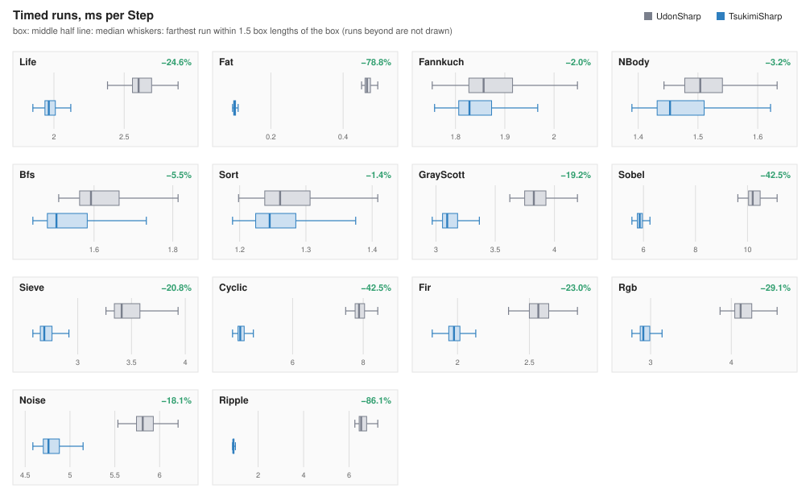

# tsharp-udon-bench

[English](README.md)

同じ C# のコードを UdonSharp と TsukimiSharp（T#）でそれぞれコンパイルし、同じ Unity のシーンの Udon の上で走らせて時間を比べたベンチマークです。

## ベンチマーク

14 本です。「Step」は 1 回の計時で `Step()` を呼ぶ回数です。

| ベンチマーク | 1 Step の中身 | Step |
|:--|:--|--:|
| Life | 32×32 のトーラスでのライフゲーム（B3/S23）。2 枚の配列を入れ替える | 30 |
| Fat | 256 セルのビットの環。各セルが約 28 個の整数演算のブロックを計算し直す | 100 |
| Fannkuch | fannkuch-redux、n = 7、1 Step で 240 通りの順列（21 Step でちょうど 1 周） | 21 |
| NBody | 太陽と 4 つの巨大惑星。`float` と `Vector3`、1 Step で 100 回進める | 30 |
| Bfs | 壁 28% の 32×32 の格子で、1 マスを入れ替えてから幅優先探索 | 30 |
| Sort | 256 個の `int` を反復版のクイックソート（Hoare の分割・明示のスタック）で並べる | 30 |
| GrayScott | 32×32 のトーラスで固定小数点の Gray-Scott 反応拡散 | 30 |
| Sobel | 48×48 のグレースケール画像に Sobel のエッジ検出をかけ、画像へ混ぜ戻す | 10 |
| Sieve | `bool` 配列で 4096 までのエラトステネスのふるい。素数と双子素数を数える | 21 |
| Cyclic | 32×32 のトーラスでの巡回セル・オートマトン（8 状態）。小さなヘルパーメソッドで書いてある | 10 |
| Fir | 1024 サンプルのリングに 5 タップの FIR ローパスをかける（TsukimiSharp の展開が効くよう、int の定数を小さく保った） | 30 |
| Rgb | 32×32 の 0xRRGGBB の画素のコントラストと明るさを変え、ヒストグラムを作る | 30 |
| Noise | 固定小数点の 2 次元バリューノイズ、2 オクターブ | 10 |
| Ripple | 2 枚の 32×32 の配列で回す水面の波紋。小さなヘルパーメソッドで書いてある。4 Step ごとに雨粒が落ちる | 21 |

各ベンチマークの本体のコードは `bodies/<Name>.body.cs` にあります。下のベンチマークを開くと、中身・出典・コードが見られます。

<!-- bodies:start -->
<details>
<summary><b>Life</b></summary>

端が回り込む 32×32 のトーラスでのライフゲーム（B3/S23）。乱数の初期形（seed 12345）から始める。1 Step で全部のセルの 8 近傍を数え、2 枚の配列を入れ替える。checksum はセルの位置つきのハッシュ（生きているセルの数も数えるが、照合はしない）。

考察: 近傍の添字は、`ym * n + xm` の `ym * n` のように同じ掛け算を何度も使う。TsukimiSharp は繰り返す式を 1 回にまとめ、内側のループで変わらない `ym * n` などをループの外へ出す。Udon では演算 1 つが extern の呼び出し 1 回なので、減った掛け算がそのまま時間に効く。

出典: Martin Gardner, "Mathematical Games: The fantastic combinations of John Conway's new solitaire game 'life'", Scientific American 223(4), 1970 年 10 月, pp. 120–123。

`bodies/Life.body.cs`

```csharp
// Conway's Game of Life on a size x size torus (edges wrap).
// Cells are 0/1 in a flat int array; two buffers are swapped after each step.
public int size = 32;
public int seed = 12345;
public int checksum;
public int population;

int[] cur;
int[] nxt;

void Start()
{
    Init();
}

public void Init()
{
    int n = size;
    cur = new int[n * n];
    nxt = new int[n * n];
    int s = seed;
    for (int i = 0; i < n * n; i++)
    {
        s = (s * 75 + 74) % 65537;
        cur[i] = (s % 3 == 0) ? 1 : 0;
    }
    checksum = 0;
    population = 0;
}

public void Step()
{
    int n = size;
    for (int y = 0; y < n; y++)
    {
        int ym = (y + n - 1) % n;
        int yp = (y + 1) % n;
        for (int x = 0; x < n; x++)
        {
            int xm = (x + n - 1) % n;
            int xp = (x + 1) % n;
            int c = cur[ym * n + xm] + cur[ym * n + x] + cur[ym * n + xp]
                  + cur[y * n + xm] + cur[y * n + xp]
                  + cur[yp * n + xm] + cur[yp * n + x] + cur[yp * n + xp];
            int alive = cur[y * n + x];
            nxt[y * n + x] = (c == 3 || (c == 2 && alive == 1)) ? 1 : 0;
        }
    }
    int[] t = cur;
    cur = nxt;
    nxt = t;
}

public void ComputeChecksum()
{
    int n = size;
    int h = 0;
    int pop = 0;
    for (int i = 0; i < n * n; i++)
    {
        pop += cur[i];
        h = (h * 31 + cur[i] * (i % 1000 + 1)) % 1000003;
    }
    population = pop;
    checksum = h;
}
```

</details>

<details>
<summary><b>Fat</b></summary>

256 ビットの環。1 Step で、各セルごとに同じ整数演算のブロックを計算し直す。ブロックは Step の間に変わらないフィールドしか読まない。次のビットは隣と、そのブロックの値から決める（next[i] = (cur[i + 1] + bit) & 1）。

考察: ブロックは Step の間に変わらないフィールドしか読まないので、本来はループの外へ出せる。ただ Udon では、フィールドは別の Behaviour から名前で書き換えられ、宣言と違う型の値が入りうる。そのフィールドから作った式をループの前へ出すと、0 回しか回らないループでも式が走り、元のプログラムなら止まらない所で止まりうる。そこで今の TsukimiSharp は、ループの前で宣言の型として一度読まれたフィールドから作った式だけを外へ出す。このベンチマークではブロックのフィールドがループの前で一度も読まれないので、ブロックはループの中に残り、差はほとんど出ない。

出典: 作者が書いたベンチマーク。

`bodies/Fat.body.cs`

```csharp
// A one-dimensional ring of bits where every cell recomputes the same heavy
// arithmetic block. The block only reads fields that do not change during the
// step, so its value is the same for every cell (loop-invariant). The varying
// part is a single shifted read: next[i] = (cur[i + 1] + bit) & 1.
public int size = 256;
public int seed = 2024;
public int ka = 7;
public int kb = 13;
public int kc = 29;
public int kd = 101;
public int checksum;

int[] cur;
int[] nxt;

void Start()
{
    Init();
}

public void Init()
{
    int n = size;
    cur = new int[n];
    nxt = new int[n];
    int s = seed;
    for (int i = 0; i < n; i++)
    {
        s = (s * 75 + 74) % 65537;
        cur[i] = s & 1;
    }
    checksum = 0;
}

public void Step()
{
    int n = size;
    for (int i = 0; i < n; i++)
    {
        int a = ka * kb + kc;
        int b = (a ^ kd) + (ka - kc) * 3;
        int c = (b & 1023) * (kb | 5) - (kd >> 2);
        int d = (c + a) % 977 + (b ^ c) % 13;
        int e = d * d - a + (kc & kd);
        int f = (e >> 3) + (e & 7) * kb;
        int bit = (f + c - b) & 1;
        nxt[i] = (cur[(i + 1) % n] + bit) & 1;
    }
    int[] t = cur;
    cur = nxt;
    nxt = t;
}

public void ComputeChecksum()
{
    int n = size;
    int h = 0;
    for (int i = 0; i < n; i++)
    {
        h = (h * 31 + cur[i] * (i + 1)) % 1000003;
    }
    checksum = h;
}
```

</details>

<details>
<summary><b>Fannkuch</b></summary>

n = 7 の fannkuch-redux。0..6 の順列を決まった順で全部たどり、各順列で先頭の p[0] + 1 個を p[0] が 0 になるまで反転し、反転の回数を数える。checksum は回数を交互の符号で足した値で、回数の最大も持つ。1 Step で 240 通り。7! 通りを全部たどるのに 21 Step かかり、checksum 228・最大 16 になる。

考察: 短いループの中の配列の読み書きが中心で、同じ式の繰り返しも小さなメソッドの呼び出しもほとんど無い。TsukimiSharp が取り除ける余分が少なく、差は小さい。

出典: The Computer Language Benchmarks Game の fannkuch-redux（https://benchmarksgame-team.pages.debian.net/benchmarksgame/description/fannkuchredux.html）。元は Kenneth R. Anderson, Duane Rettig, "Performing Lisp Analysis of the FANNKUCH Benchmark", ACM SIGPLAN Lisp Pointers VII(4), 1994 年, pp. 2–12。

`bodies/Fannkuch.body.cs`

```csharp
// fannkuch-redux: walk every permutation of 0..n-1 in a fixed order; for each,
// keep reversing the first (p[0] + 1) elements until p[0] == 0 and count the
// reversals. checksum = sum of flip counts with alternating sign (even index +,
// odd index -), maxFlips = the largest count. One Step handles `chunk`
// permutations; when all n! are done the totals are published and the walk
// starts over.
public int n = 7;
public int chunk = 240;
public int checksum;
public int maxFlips;
public int cycles;

int[] perm1;
int[] perm;
int[] count;
int r;
int permIndex;
int sum;
int best;

void Start()
{
    Init();
}

public void Init()
{
    perm1 = new int[n];
    perm = new int[n];
    count = new int[n];
    ResetCycle();
    checksum = 0;
    maxFlips = 0;
    cycles = 0;
}

void ResetCycle()
{
    for (int i = 0; i < n; i++) perm1[i] = i;
    r = n;
    permIndex = 0;
    sum = 0;
    best = 0;
}

public void Step()
{
    for (int k = 0; k < chunk; k++)
    {
        while (r != 1)
        {
            count[r - 1] = r;
            r--;
        }

        for (int i = 0; i < n; i++) perm[i] = perm1[i];
        int flips = 0;
        int first = perm[0];
        while (first != 0)
        {
            int lo = 0;
            int hi = first;
            while (lo < hi)
            {
                int t = perm[lo];
                perm[lo] = perm[hi];
                perm[hi] = t;
                lo++;
                hi--;
            }
            flips++;
            first = perm[0];
        }
        if (flips > best) best = flips;
        if (permIndex % 2 == 0) sum += flips;
        else sum -= flips;

        bool finished = false;
        while (true)
        {
            if (r == n)
            {
                finished = true;
                break;
            }
            int p0 = perm1[0];
            for (int i = 0; i < r; i++) perm1[i] = perm1[i + 1];
            perm1[r] = p0;
            count[r] = count[r] - 1;
            if (count[r] > 0) break;
            r++;
        }
        permIndex++;

        if (finished)
        {
            checksum = sum;
            maxFlips = best;
            cycles++;
            ResetCycle();
        }
    }
}

public void ComputeChecksum()
{
    // checksum and maxFlips are published when a full walk ends (see Step).
}
```

</details>

<details>
<summary><b>NBody</b></summary>

太陽と 4 つの巨大惑星を float と Vector3 で。シンプレクティック・オイラー法で dt = 0.01、1 Step で 100 回進める。初期の位置・速度・質量は Benchmarks Game の n-body の値を float に丸めた物。checksum は全エネルギー（絶対値 1e-4 の許容幅で照合）。

考察: ここでは演算のほとんど（Vector3 の演算子・float の計算・配列の読み書き・Mathf.Sqrt）が 1 回ずつ extern の呼び出しになる。どちらで組んでも同じ物を同じ回数呼ぶので、差はほとんど出ない。

出典: The Computer Language Benchmarks Game の n-body（https://benchmarksgame-team.pages.debian.net/benchmarksgame/description/nbody.html）。

`bodies/NBody.body.cs`

```csharp
// n-body: the Sun and the four gas giants, symplectic Euler with dt = 0.01
// (units: AU, days/365.24, solar masses scaled so G = 1). float + Vector3.
// One Step advances `substeps` times. checksum = total energy.
public int substeps = 100;
public float dt = 0.01f;
public float checksum;

Vector3[] pos;
Vector3[] vel;
float[] mass;

void Start()
{
    Init();
}

public void Init()
{
    float pi = 3.141592653589793f;
    float solarMass = 4f * pi * pi;
    float daysPerYear = 365.24f;
    pos = new Vector3[5];
    vel = new Vector3[5];
    mass = new float[5];

    pos[0] = Vector3.zero;
    vel[0] = Vector3.zero;
    mass[0] = solarMass;

    pos[1] = new Vector3(4.84143144246472090e+00f, -1.16032004402742839e+00f, -1.03622044471123109e-01f);
    vel[1] = new Vector3(1.66007664274403694e-03f, 7.69901118419740425e-03f, -6.90460016972063023e-05f) * daysPerYear;
    mass[1] = 9.54791938424326609e-04f * solarMass;

    pos[2] = new Vector3(8.34336671824457987e+00f, 4.12479856412430479e+00f, -4.03523417114321381e-01f);
    vel[2] = new Vector3(-2.76742510726862411e-03f, 4.99852801234917238e-03f, 2.30417297573763929e-05f) * daysPerYear;
    mass[2] = 2.85885980666130812e-04f * solarMass;

    pos[3] = new Vector3(1.28943695621391310e+01f, -1.51111514016986312e+01f, -2.23307578892655734e-01f);
    vel[3] = new Vector3(2.96460137564761618e-03f, 2.37847173959480950e-03f, -2.96589568540237556e-05f) * daysPerYear;
    mass[3] = 4.36624404335156298e-05f * solarMass;

    pos[4] = new Vector3(1.53796971148509165e+01f, -2.59193146099879641e+01f, 1.79258772950371181e-01f);
    vel[4] = new Vector3(2.68067772490389322e-03f, 1.62824170038242295e-03f, -9.51592254519715870e-05f) * daysPerYear;
    mass[4] = 5.15138902046611451e-05f * solarMass;

    // Give the Sun the momentum that makes the total zero.
    Vector3 p = Vector3.zero;
    for (int i = 0; i < 5; i++) p = p + vel[i] * mass[i];
    vel[0] = p * (-1f / solarMass);
    checksum = 0f;
}

public void Step()
{
    for (int s = 0; s < substeps; s++)
    {
        for (int i = 0; i < 5; i++)
        {
            for (int j = i + 1; j < 5; j++)
            {
                Vector3 d = pos[i] - pos[j];
                float d2 = d.sqrMagnitude;
                float mag = dt / (d2 * Mathf.Sqrt(d2));
                vel[i] = vel[i] - d * (mass[j] * mag);
                vel[j] = vel[j] + d * (mass[i] * mag);
            }
        }
        for (int i = 0; i < 5; i++)
        {
            pos[i] = pos[i] + vel[i] * dt;
        }
    }
}

public void ComputeChecksum()
{
    float e = 0f;
    for (int i = 0; i < 5; i++)
    {
        e += 0.5f * mass[i] * vel[i].sqrMagnitude;
        for (int j = i + 1; j < 5; j++)
        {
            Vector3 d = pos[i] - pos[j];
            e -= mass[i] * mass[j] / Mathf.Sqrt(d.sqrMagnitude);
        }
    }
    checksum = e;
}
```

</details>

<details>
<summary><b>Bfs</b></summary>

壁が 28% の 32×32 の格子（seed 4242）。1 Step で 1 マスの壁と床を入れ替え（始点と終点は除く）、左上から 4 近傍の幅優先探索をする。キューは int 配列。右下までの距離と、届いたマスの数をハッシュに畳む。

考察: extern の呼び出しは両方でほぼ同じで、差の大半は値を運ぶ命令（PUSH・COPY）の数から来る。TsukimiSharp は extern の結果をローカル変数へ直接書き、`width - 1` と `height - 1` をループの外へ出す。差は小さい。

出典: E. F. Moore, "The shortest path through a maze", Proceedings of an International Symposium on the Theory of Switching, Part II（Annals of the Computation Laboratory of Harvard University 30）, Harvard University Press, 1959 年, pp. 285–292。

`bodies/Bfs.body.cs`

```csharp
// Breadth-first search on a width x height grid with walls, from the top-left
// cell to every reachable cell (4-neighbourhood). Each Step first flips one
// cell between wall and floor (never the start or the goal), then searches.
// The distance to the bottom-right cell and the number of reached cells are
// folded into a running hash.
public int width = 32;
public int height = 32;
public int seed = 4242;
public int wallPercent = 28;
public int checksum;
public int lastDistance;

int[] wall;
int[] dist;
int[] queue;
int rng;
int acc;

void Start()
{
    Init();
}

int NextRandom()
{
    rng = (rng * 75 + 74) % 65537;
    return rng;
}

public void Init()
{
    int n = width * height;
    wall = new int[n];
    dist = new int[n];
    queue = new int[n];
    rng = seed;
    for (int i = 0; i < n; i++)
    {
        wall[i] = (NextRandom() % 100 < wallPercent) ? 1 : 0;
    }
    // Keep the start, the goal and their neighbours open.
    wall[0] = 0;
    wall[1] = 0;
    wall[width] = 0;
    wall[n - 1] = 0;
    wall[n - 2] = 0;
    wall[n - 1 - width] = 0;
    acc = 0;
    checksum = 0;
    lastDistance = 0;
}

public void Step()
{
    int n = width * height;
    int flip = NextRandom() % n;
    if (flip != 0 && flip != n - 1) wall[flip] = 1 - wall[flip];

    for (int i = 0; i < n; i++) dist[i] = -1;
    int head = 0;
    int tail = 0;
    dist[0] = 0;
    queue[tail] = 0;
    tail++;
    while (head < tail)
    {
        int c = queue[head];
        head++;
        int cx = c % width;
        int cy = c / width;
        int nd = dist[c] + 1;
        if (cx > 0)
        {
            int nb = c - 1;
            if (wall[nb] == 0 && dist[nb] < 0) { dist[nb] = nd; queue[tail] = nb; tail++; }
        }
        if (cx < width - 1)
        {
            int nb = c + 1;
            if (wall[nb] == 0 && dist[nb] < 0) { dist[nb] = nd; queue[tail] = nb; tail++; }
        }
        if (cy > 0)
        {
            int nb = c - width;
            if (wall[nb] == 0 && dist[nb] < 0) { dist[nb] = nd; queue[tail] = nb; tail++; }
        }
        if (cy < height - 1)
        {
            int nb = c + width;
            if (wall[nb] == 0 && dist[nb] < 0) { dist[nb] = nd; queue[tail] = nb; tail++; }
        }
    }
    lastDistance = dist[n - 1];
    acc = (acc * 31 + (lastDistance + 1) * 1009 + tail) % 1000003;
}

public void ComputeChecksum()
{
    checksum = acc;
}
```

</details>

<details>
<summary><b>Sort</b></summary>

256 個の int を乱数で埋め、反復版のクイックソートでその場で並べる（Hoare の分割・中央の要素を軸・明示のスタック・小さい側を先に）。整列の確かめと、抜き取った要素をハッシュに畳む。

考察: 再帰の代わりに明示のスタックを使い、分割もループの中に直に書いた、手で詰めた形。同じ式の繰り返しが少なく、メソッドの呼び出しも無いので、TsukimiSharp にも取り除ける余分がほとんど無く、UdonSharp と同じ速さになる。

出典: C. A. R. Hoare, "Quicksort", The Computer Journal 5(1), 1962 年, pp. 10–16。

`bodies/Sort.body.cs`

```csharp
// Fill an int array with pseudo-random values, then sort it in place with an
// iterative quicksort (Hoare partition, middle element as pivot, explicit
// stack, smaller side first). A few sampled elements and a sortedness check
// are folded into a running hash.
public int length = 256;
public int seed = 777;
public int checksum;

int[] a;
int[] stack;
int rng;
int acc;

void Start()
{
    Init();
}

public void Init()
{
    a = new int[length];
    stack = new int[128];
    rng = seed;
    acc = 0;
    checksum = 0;
}

public void Step()
{
    int n = length;
    for (int f = 0; f < n; f++)
    {
        rng = (rng * 75 + 74) % 65537;
        a[f] = rng;
    }

    int sp = 0;
    stack[0] = 0;
    stack[1] = n - 1;
    sp = 2;
    while (sp > 0)
    {
        sp -= 2;
        int lo = stack[sp];
        int hi = stack[sp + 1];
        if (lo >= hi) continue;

        int pivot = a[(lo + hi) / 2];
        int i = lo - 1;
        int j = hi + 1;
        while (true)
        {
            i++;
            while (a[i] < pivot) i++;
            j--;
            while (a[j] > pivot) j--;
            if (i >= j) break;
            int t = a[i];
            a[i] = a[j];
            a[j] = t;
        }

        // [lo, j] and [j + 1, hi]: push the larger range first so the smaller is handled next.
        if (j - lo < hi - j - 1)
        {
            stack[sp] = j + 1; stack[sp + 1] = hi; sp += 2;
            stack[sp] = lo; stack[sp + 1] = j; sp += 2;
        }
        else
        {
            stack[sp] = lo; stack[sp + 1] = j; sp += 2;
            stack[sp] = j + 1; stack[sp + 1] = hi; sp += 2;
        }
    }

    int bad = 0;
    for (int k = 0; k + 1 < n; k++)
    {
        if (a[k] > a[k + 1]) bad++;
    }
    acc = (acc * 31 + a[n / 2] + a[n / 4] * 7 + bad * 100000) % 1000003;
}

public void ComputeChecksum()
{
    checksum = acc;
}
```

</details>

<details>
<summary><b>GrayScott</b></summary>

32×32 のトーラスでの Gray-Scott 反応拡散を固定小数点で（4096 = 1.0。値は全部 int で、結果はどこで回してもビット単位で同じ）。5 点のラプラシアン・dt = 1・Du = 0.16・Dv = 0.08・F = 0.035・k = 0.065。値は [0, 1] に収める。

考察: Life と同じく、5 点のラプラシアンの添字で同じ掛け算を繰り返す。TsukimiSharp はそれを 1 回にまとめ、内側のループで変わらない物をループの外へ出す。

出典: John E. Pearson, "Complex Patterns in a Simple System", Science 261(5118), 1993 年, pp. 189–192。

`bodies/GrayScott.body.cs`

```csharp
// Gray-Scott reaction-diffusion on a size x size torus in fixed point
// (4096 = 1.0, so every value is an int and the result is the same bit for
// bit everywhere).
// du/dt = Du * lap(u) - u*v*v + F * (1 - u)
// dv/dt = Dv * lap(v) + u*v*v - (F + k) * v      (dt = 1, 5-point Laplacian)
public int size = 32;
public int diffU = 655;   // 0.16
public int diffV = 328;   // 0.08
public int feed = 143;    // 0.035
public int kill = 266;    // 0.065
public int checksum;

int[] u;
int[] v;
int[] u2;
int[] v2;

void Start()
{
    Init();
}

public void Init()
{
    int n = size;
    u = new int[n * n];
    v = new int[n * n];
    u2 = new int[n * n];
    v2 = new int[n * n];
    for (int i = 0; i < n * n; i++)
    {
        u[i] = 4096;
        v[i] = 0;
    }
    int lo = n / 2 - 4;
    int hi = n / 2 + 4;
    for (int y = lo; y < hi; y++)
    {
        for (int x = lo; x < hi; x++)
        {
            u[y * n + x] = 2048;
            v[y * n + x] = 1024 + (x * 37 + y * 11) % 256;
        }
    }
    checksum = 0;
}

public void Step()
{
    int n = size;
    for (int y = 0; y < n; y++)
    {
        int ym = (y + n - 1) % n;
        int yp = (y + 1) % n;
        for (int x = 0; x < n; x++)
        {
            int xm = (x + n - 1) % n;
            int xp = (x + 1) % n;
            int i = y * n + x;
            int uc = u[i];
            int vc = v[i];
            int lu = u[ym * n + x] + u[yp * n + x] + u[y * n + xm] + u[y * n + xp] - 4 * uc;
            int lv = v[ym * n + x] + v[yp * n + x] + v[y * n + xm] + v[y * n + xp] - 4 * vc;
            int uv = (uc * vc) >> 12;
            int uvv = (uv * vc) >> 12;
            int nu = uc + ((diffU * lu) >> 12) - uvv + ((feed * (4096 - uc)) >> 12);
            int nv = vc + ((diffV * lv) >> 12) + uvv - (((feed + kill) * vc) >> 12);
            if (nu < 0) nu = 0;
            if (nu > 4096) nu = 4096;
            if (nv < 0) nv = 0;
            if (nv > 4096) nv = 4096;
            u2[i] = nu;
            v2[i] = nv;
        }
    }
    int[] t = u;
    u = u2;
    u2 = t;
    t = v;
    v = v2;
    v2 = t;
}

public void ComputeChecksum()
{
    int n = size;
    int h = 0;
    for (int i = 0; i < n * n; i++)
    {
        h = (h * 31 + v[i] + u[i] * 3) % 1000003;
    }
    checksum = h;
}
```

</details>

<details>
<summary><b>Sobel</b></summary>

48×48 のグレースケール画像（0..255）に Sobel のエッジ検出をかける。1 Step で内側の全画素の |gx| + |gy|（255 で頭打ち）を求め、画像へ混ぜ戻す（(img × 3 + edge) / 4）。次の Step は別の絵を見る。

考察: 3×3 の近傍を素直に書くと、`(y - 1) * w` や `x - 1` のような添字の式が 1 画素あたり何度も出る。UdonSharp は書いたとおり全部計算し、TsukimiSharp は同じ式を 1 回にまとめ、行ごとの掛け算を内側のループの外へ出す。組んだプログラムの内側のループの本体には、UdonSharp では掛け算が 17 個（extern の呼び出しは全部で 82 個）、TsukimiSharp では 4 個（全部で 44 個）ある。Udon では足し算も掛け算も 1 回ずつ extern の呼び出しなので、ここが時間の大半を占める。

出典: Irwin Sobel, Gary Feldman, "A 3×3 Isotropic Gradient Operator for Image Processing", Stanford Artificial Intelligence Project での発表, 1968 年。

`bodies/Sobel.body.cs`

```csharp
// Sobel edge detection on a size x size grayscale image (values 0..255).
// Each Step computes the edge magnitude |gx| + |gy| (capped at 255) for every
// inner pixel, then blends the edges back into the image so that the next
// Step sees a different picture. Border pixels of the edge image stay 0.
public int size = 48;
public int seed = 777;
public int checksum;

int[] img;
int[] edge;

void Start()
{
    Init();
}

public void Init()
{
    int n = size;
    img = new int[n * n];
    edge = new int[n * n];
    int s = seed;
    for (int i = 0; i < img.Length; i++)
    {
        s = (s * 75 + 74) % 65537;
        img[i] = s % 256;
    }
    checksum = 0;
}

public void Step()
{
    int w = size;
    for (int y = 1; y < w - 1; y++)
    {
        for (int x = 1; x < w - 1; x++)
        {
            int gx = -img[(y - 1) * w + (x - 1)] + img[(y - 1) * w + (x + 1)]
                     - 2 * img[y * w + (x - 1)] + 2 * img[y * w + (x + 1)]
                     - img[(y + 1) * w + (x - 1)] + img[(y + 1) * w + (x + 1)];
            int gy = -img[(y - 1) * w + (x - 1)] - 2 * img[(y - 1) * w + x] - img[(y - 1) * w + (x + 1)]
                     + img[(y + 1) * w + (x - 1)] + 2 * img[(y + 1) * w + x] + img[(y + 1) * w + (x + 1)];
            if (gx < 0) gx = -gx;
            if (gy < 0) gy = -gy;
            int m = gx + gy;
            if (m > 255) m = 255;
            edge[y * w + x] = m;
        }
    }
    for (int i = 0; i < img.Length; i++)
    {
        img[i] = (img[i] * 3 + edge[i]) / 4;
    }
}

public void ComputeChecksum()
{
    int h = 0;
    for (int i = 0; i < img.Length; i++)
    {
        h = (h * 31 + img[i] * (i % 1000 + 1)) % 1000003;
    }
    checksum = h;
}
```

</details>

<details>
<summary><b>Sieve</b></summary>

4096 要素の bool 配列でエラトステネスのふるい。続けて素数をたどり、素数と双子素数を数え、位置をハッシュに畳む。1 Step ごとにふるいを最初からやり直し、ハッシュは Step をまたいで持ち越す。

考察: どのループも条件で `composite.Length` を読み、UdonSharp は毎周 `.Length` を extern の呼び出しで読む（組んだプログラムには、ループの条件ごとに 1 つ、全部で 4 つある）。配列はループの中で変わらないので、TsukimiSharp は `.Length` を最初のループの前で 1 回だけ読む。

出典: エラトステネスのふるい（キュレネのエラトステネス・紀元前 3 世紀）。記述はゲラサのニコマコス『算術入門』第 1 巻 13 章（Martin Luther D'Ooge 訳, Macmillan, 1926 年, pp. 204–206）。

`bodies/Sieve.body.cs`

```csharp
// The sieve of Eratosthenes over a bool array, then a walk over the primes
// that counts them, counts twin primes, and hashes their positions.
// Each Step runs the whole sieve again; the hash carries over from Step to Step.
public int limit = 4096;
public int checksum;
public int primeCount;

bool[] composite;
int acc;
int round;

void Start()
{
    Init();
}

public void Init()
{
    composite = new bool[limit];
    acc = 0;
    round = 0;
    checksum = 0;
    primeCount = 0;
}

public void Step()
{
    for (int i = 0; i < composite.Length; i++)
    {
        composite[i] = false;
    }
    composite[0] = true;
    composite[1] = true;
    for (int i = 2; i * i < composite.Length; i++)
    {
        if (!composite[i])
        {
            for (int j = i * i; j < composite.Length; j += i)
            {
                composite[j] = true;
            }
        }
    }
    int count = 0;
    int twins = 0;
    int h = round;
    for (int i = 2; i < composite.Length; i++)
    {
        if (!composite[i])
        {
            count++;
            if (i > 2 && !composite[i - 2])
            {
                twins++;
            }
            h = (h * 31 + i) % 1000003;
        }
    }
    primeCount = count;
    acc = (acc * 7 + count * 13 + twins * 5 + h) % 1000003;
    round++;
}

public void ComputeChecksum()
{
    checksum = acc;
}
```

</details>

<details>
<summary><b>Cyclic</b></summary>

32×32 のトーラスでの巡回セル・オートマトン。状態 8 つ・近傍 8 マス・しきい値 2。次の状態にある近傍が 2 つ以上あれば、そのセルは次の状態へ進む（最後の次は 0）。小さなヘルパーメソッド（Wrap・At・CountState）で書いた。

考察: 規則を Wrap・At・CountState の 3 つの小さなメソッドで書いたので、1 セルあたり 28 回の呼び出しがある。UdonSharp のメソッドの呼び出しは、引数の写し・戻り先の積み下ろし・ジャンプで、組んだプログラムでは 1 回ごとに 8〜14 個の命令がかかる（引数の数で変わる）。TsukimiSharp は 3 つともインライン化するので、呼び出しの費用がまるごと消える。

出典: Robert Fisch, Janko Gravner, David Griffeath, "Cyclic cellular automata in two dimensions", K. S. Alexander, J. C. Watkins 編, Spatial Stochastic Processes（Progress in Probability 19）所収, Birkhäuser, 1991 年, pp. 171–185。

`bodies/Cyclic.body.cs`

```csharp
// A cyclic cellular automaton on a size x size torus: every cell holds a
// state 0..states-1 and moves on to the next state (wrapping to 0) when at
// least `threshold` of its 8 neighbours already hold that next state.
// Written with small helper methods (Wrap, At, CountState), the way the
// rule is usually spelled out.
public int size = 32;
public int states = 8;
public int threshold = 2;
public int seed = 31337;
public int checksum;

int[] cur;
int[] nxt;

void Start()
{
    Init();
}

public void Init()
{
    int n = size;
    cur = new int[n * n];
    nxt = new int[n * n];
    int s = seed;
    for (int i = 0; i < cur.Length; i++)
    {
        s = (s * 75 + 74) % 65537;
        cur[i] = s % states;
    }
    checksum = 0;
}

int Wrap(int v)
{
    return (v + size) % size;
}

int At(int x, int y)
{
    return cur[Wrap(y) * size + Wrap(x)];
}

int CountState(int x, int y, int target)
{
    int c = 0;
    if (At(x - 1, y - 1) == target) c++;
    if (At(x, y - 1) == target) c++;
    if (At(x + 1, y - 1) == target) c++;
    if (At(x - 1, y) == target) c++;
    if (At(x + 1, y) == target) c++;
    if (At(x - 1, y + 1) == target) c++;
    if (At(x, y + 1) == target) c++;
    if (At(x + 1, y + 1) == target) c++;
    return c;
}

public void Step()
{
    int n = size;
    for (int y = 0; y < n; y++)
    {
        for (int x = 0; x < n; x++)
        {
            int s = At(x, y);
            int next = (s + 1) % states;
            nxt[y * n + x] = CountState(x, y, next) >= threshold ? next : s;
        }
    }
    int[] t = cur;
    cur = nxt;
    nxt = t;
}

public void ComputeChecksum()
{
    int h = 0;
    for (int i = 0; i < cur.Length; i++)
    {
        h = (h * 31 + cur[i] * (i % 1000 + 1)) % 1000003;
    }
    checksum = h;
}
```

</details>

<details>
<summary><b>Fir</b></summary>

1024 サンプルの int のリングに、二項係数の重み 1 4 6 4 1（和 16）の 5 タップ FIR ローパスをかける。1 Step で 64 サンプルのノイズを書き足し、リング全体を別の配列へ濾す。

考察: 5 タップの内側のループは回数が定数（5 回）。TsukimiSharp はこれを展開し、毎周の比較と `k++` を消す。この展開は、プログラムにコードの長さ（バイト）以上の int 定数があると行われないので、このベンチマークは int の定数を小さく保ってある（本体のコードのコメントのとおり）。

出典: 作者が書いたベンチマーク。

`bodies/Fir.body.cs`

```csharp
// A 5-tap FIR low-pass filter (binomial weights 1 4 6 4 1, sum 16)
// over a ring buffer of integer samples, the way audio-style code is written.
// Each Step writes a block of new noise samples into the ring, then filters
// the whole ring into filtered[].
// Every int constant is kept small on purpose (PRNG modulus 1021, hash moduli
// 1009 and 997): the TsukimiSharp optimizer unrolls the 5-tap loop only when no int
// constant in the program is as large as the program's code size in bytes.
public int length = 1024;
public int block = 64;
public int seed = 99;
public int checksum;

int[] samples;
int[] filtered;
int[] taps;
int head;
int rng;

void Start()
{
    Init();
}

public void Init()
{
    samples = new int[length];
    filtered = new int[length];
    taps = new int[5];
    taps[0] = 1;
    taps[1] = 4;
    taps[2] = 6;
    taps[3] = 4;
    taps[4] = 1;
    rng = seed;
    head = 0;
    for (int i = 0; i < samples.Length; i++)
    {
        rng = (rng * 75 + 74) % 1021;
        samples[i] = rng % 201 - 100;
    }
    checksum = 0;
}

public void Step()
{
    int n = samples.Length;
    for (int i = 0; i < block; i++)
    {
        rng = (rng * 75 + 74) % 1021;
        samples[(head + i) % n] = rng % 201 - 100;
    }
    head = (head + block) % n;
    for (int i = 0; i < n; i++)
    {
        int acc = 0;
        for (int k = 0; k < 5; k++)
        {
            acc += taps[k] * samples[(i + k) % n];
        }
        filtered[i] = acc / 16;
    }
}

public void ComputeChecksum()
{
    int h1 = 0;
    int h2 = 0;
    for (int i = 0; i < filtered.Length; i++)
    {
        int v = filtered[i] + 100;
        h1 = (h1 * 31 + v * (i % 100 + 1)) % 1009;
        h2 = (h2 * 37 + v) % 997;
    }
    checksum = h1 * 1000 + h2;
}
```

</details>

<details>
<summary><b>Rgb</b></summary>

32×32 の 0xRRGGBB の画素のコントラストと明るさを、小さなヘルパー（Channel・Adjust はチャンネル番号を引数に取る。Clamp255・Pack は取らない）で変える。明るさのずらしは Step ごとに変わる。1 Step ごとに濃淡値のヒストグラムも作る。

考察: チャンネル番号をリテラルで渡すヘルパー（Channel・Adjust）を TsukimiSharp がインライン化すると、`8 * c` や `3 + c` が定数に畳まれ、1 画素あたりの extern の呼び出しが減る。Clamp255 と Pack はインライン化されず、呼び出しのまま残る。

出典: 作者が書いたベンチマーク。

`bodies/Rgb.body.cs`

```csharp
// Colour adjustment on packed 0xRRGGBB pixels, written with small helpers
// (Channel and Adjust take the channel number as an argument, Clamp255 and
// Pack do not; channel 0 = blue, 1 = green, 2 = red). Each Step lowers the contrast
// a little and shifts the brightness per channel (the shift changes from
// Step to Step), writes the pixels back, and builds a histogram of the gray values.
public int size = 32;
public int seed = 4711;
public int checksum;

int[] pixels;
int[] hist;
int round;

void Start()
{
    Init();
}

public void Init()
{
    int n = size;
    pixels = new int[n * n];
    hist = new int[256];
    int s = seed;
    for (int i = 0; i < pixels.Length; i++)
    {
        s = (s * 75 + 74) % 65537;
        int r = s % 256;
        s = (s * 75 + 74) % 65537;
        int g = s % 256;
        s = (s * 75 + 74) % 65537;
        int b = s % 256;
        pixels[i] = (r << 16) | (g << 8) | b;
    }
    round = 0;
    checksum = 0;
}

int Channel(int rgb, int c)
{
    return (rgb >> (8 * c)) & 255;
}

int Clamp255(int v)
{
    if (v < 0) return 0;
    if (v > 255) return 255;
    return v;
}

int Adjust(int v, int c, int shift)
{
    int gain = 3 + c;
    return Clamp255(((v - 128) * 15) / 16 + 128 + shift * gain);
}

int Pack(int r, int g, int b)
{
    return (r << 16) | (g << 8) | b;
}

public void Step()
{
    int shift = round % 7 - 3;
    for (int i = 0; i < hist.Length; i++)
    {
        hist[i] = 0;
    }
    for (int i = 0; i < pixels.Length; i++)
    {
        int p = pixels[i];
        int r = Adjust(Channel(p, 2), 2, shift);
        int g = Adjust(Channel(p, 1), 1, shift);
        int b = Adjust(Channel(p, 0), 0, shift);
        pixels[i] = Pack(r, g, b);
        int gray = (r * 77 + g * 150 + b * 29) >> 8;
        hist[gray] = hist[gray] + 1;
    }
    round++;
}

public void ComputeChecksum()
{
    int h = 0;
    for (int i = 0; i < hist.Length; i++)
    {
        h = (h * 31 + hist[i] * (i + 1)) % 1000003;
    }
    for (int i = 0; i < pixels.Length; i++)
    {
        h = (h * 31 + (pixels[i] % 65521) * (i % 1000 + 1)) % 1000003;
    }
    checksum = h;
}
```

</details>

<details>
<summary><b>Noise</b></summary>

固定小数点（256 = 1.0）の 2 次元バリューノイズ。格子点ごとの乱数の値を smoothstep の曲線で混ぜ、2 オクターブを足す。小さなヘルパーメソッド（Lattice・Fade・Lerp・Sample）で書いた。1 Step でずれていく位置の 24×24 のタイルを描き、ハッシュに畳む。

考察: TsukimiSharp は Lattice と Fade をインライン化する。Lerp（呼び出しの中で呼ぶ形）と Sample（2 か所から呼ぶ・大きい）は呼び出しのまま残るので、Cyclic ほどは速くならない。

出典: 作者が書いたベンチマーク。

`bodies/Noise.body.cs`

```csharp
// 2-D value noise in fixed point (256 = 1.0): a pseudo-random value at every
// lattice point, blended with a smoothstep curve, two octaves summed.
// Written with small helper methods (Lattice, Fade, Lerp, Sample), the way
// terrain or texture code usually is. Each Step renders a size x size tile at
// an offset that scrolls, and folds the tile into a hash.
public int size = 24;
public int seed = 1234;
public int checksum;

int[] field;
int offset;
int acc;

void Start()
{
    Init();
}

public void Init()
{
    field = new int[size * size];
    offset = 0;
    acc = 0;
    checksum = 0;
}

int Lattice(int x, int y)
{
    int h = (x * 7919 + y * 104729 + seed) % 65537;
    h = (h * 75 + 74) % 65537;
    return h & 255;
}

int Fade(int t)
{
    return (t * t * (768 - 2 * t)) >> 16;
}

int Lerp(int a, int b, int t)
{
    return a + (((b - a) * t) >> 8);
}

int Sample(int x, int y)
{
    int xi = x >> 8;
    int yi = y >> 8;
    int tx = Fade(x & 255);
    int ty = Fade(y & 255);
    int a = Lattice(xi, yi);
    int b = Lattice(xi + 1, yi);
    int c = Lattice(xi, yi + 1);
    int d = Lattice(xi + 1, yi + 1);
    return Lerp(Lerp(a, b, tx), Lerp(c, d, tx), ty);
}

public void Step()
{
    int n = size;
    for (int y = 0; y < n; y++)
    {
        for (int x = 0; x < n; x++)
        {
            int v = Sample(x * 40 + offset, y * 40) + Sample(x * 80 + offset * 2, y * 80 + 4096) / 2;
            field[y * n + x] = v;
        }
    }
    int h = acc;
    for (int i = 0; i < field.Length; i++)
    {
        h = (h * 31 + field[i] * (i % 1000 + 1)) % 1000003;
    }
    acc = h;
    offset = (offset + 37) % 4096;
}

public void ComputeChecksum()
{
    checksum = acc;
}
```

</details>

<details>
<summary><b>Ripple</b></summary>

2 枚の 32×32 の配列で回す水面の波紋。内側の各マスは、4 近傍の和の半分から 1 つ前の Step の自分の値を引き、その 1/32 を減らす。3×3 の近傍を Weight（上下左右が 1、ほかは 0）で書き、Tap は重みが 0 の近傍を飛ばす。4 Step に 1 度、擬似乱数の位置に雨粒が落ちる。checksum は小さな素数（1009 と 1013）を法とする 2 つのハッシュを合わせた値。

考察: どんな小さなカーネルでも書けるよう、小さなヘルパーメソッド（Index・Offset・Weight・Tap）に分けた汎用の書き方で、1 マスあたり 23 回の呼び出しがある（Index が 1 回、Tap と Weight が 9 回ずつ、Offset が重み 1 の 4 タップで 4 回）。UdonSharp は書いたとおり全部呼び、1 回ごとに引数の数に応じて 8〜14 個の命令がかかる（Cyclic と同じ数え方）。TsukimiSharp はヘルパーをインライン化する。どの呼び出しでも dx と dy が定数なので、Weight は定数に畳まれ、重みが 0 の 5 タップは配列を読まなくなり、Offset も定数になる。組んだ TsukimiSharp のプログラムでは内側のループに呼び出しが残らず、119 個の命令のうち extern の呼び出しは 29 個（配列の読みが 5 つ・書きが 1 つ）。× 1 の掛け算と + 0 の足し算が 4 つずつ残るので、1 マスの仕事は 4 近傍の和を 2 で割る形の手前まで減る。この形はわざと選んだが、よく書かれる形でもある。ふつうのコンパイラーに慣れた人は、小さな関数はインライン化されると見込んで分けて書きがちだが、UdonSharp では関数に分けた分だけ呼び出しの費用がかかる。

出典: このベンチマークのために書いた。更新の式は Hugo Elias「2D Water」（Web の頁。1998 年 12 月 2 日の保存: https://web.archive.org/web/19981202135801/http://freespace.virgin.net/hugo.elias/graphics/x_water.htm）に従う。

`bodies/Ripple.body.cs`

```csharp
// Water ripples on a 32 x 32 grid (the two-buffer wave effect). The 3x3
// neighbourhood is described by a Weight function, and Tap(i, dx, dy) reads
// the neighbour of cell i at offset (dx, dy), skipping the neighbours whose
// weight is zero, so the same helpers could describe any small kernel.
// A drop falls every fourth Step at a pseudo-random place.
const int Size = 32;

public int seed = 4242;
public int checksum;

int[] cur;
int[] prev;
int round;
int rng;

void Start()
{
    Init();
}

public void Init()
{
    cur = new int[Size * Size];
    prev = new int[Size * Size];
    rng = seed % 1021;
    round = 0;
    checksum = 0;
}

int Index(int x, int y)
{
    return y * Size + x;
}

int Offset(int dx, int dy)
{
    return dy * Size + dx;
}

int Weight(int dx, int dy)
{
    if (dx * dx + dy * dy == 1) return 1;
    return 0;
}

int Tap(int i, int dx, int dy)
{
    int w = Weight(dx, dy);
    if (w == 0) return 0;
    return cur[i + Offset(dx, dy)] * w;
}

public void Step()
{
    if (round % 4 == 0)
    {
        rng = (rng * 75 + 74) % 1021;
        int px = 2 + rng % (Size - 4);
        int py = 2 + (rng / 7) % (Size - 4);
        int d = Index(px, py);
        cur[d] = cur[d] + 400;
    }
    for (int y = 1; y < Size - 1; y++)
    {
        for (int x = 1; x < Size - 1; x++)
        {
            int i = Index(x, y);
            int sum = 0;
            sum += Tap(i, -1, -1);
            sum += Tap(i, 0, -1);
            sum += Tap(i, 1, -1);
            sum += Tap(i, -1, 0);
            sum += Tap(i, 0, 0);
            sum += Tap(i, 1, 0);
            sum += Tap(i, -1, 1);
            sum += Tap(i, 0, 1);
            sum += Tap(i, 1, 1);
            int v = sum / 2 - prev[i];
            v = v - v / 32;
            prev[i] = v;
        }
    }
    int[] t = cur;
    cur = prev;
    prev = t;
    round++;
}

public void ComputeChecksum()
{
    int h1 = 0;
    int h2 = 0;
    for (int i = 0; i < cur.Length; i++)
    {
        int v = cur[i] % 1000 + 1000;
        h1 = (h1 * 31 + v) % 1009;
        h2 = (h2 * 37 + v * (i % 97 + 1)) % 1013;
    }
    checksum = h1 * 1013 + h2;
}
```

</details>
<!-- bodies:end -->

## やり方

### 同じ本体のコードから 2 つの版を作る

各ベンチマークは、クラスのメンバーだけを書いた本体のコード 1 つです。`tools/gen.py` が同じ本体のコードにクラスの頭を付けて、UdonSharp 版と TsukimiSharp 版を作ります。違うのはクラスの頭だけで、メンバーはバイト単位で同じです。

```csharp
// UdonSharp 版
[UdonBehaviourSyncMode(BehaviourSyncMode.None)]
public class LifeU : UdonSharpBehaviour { ...本体のコード... }

// TsukimiSharp 版
public partial class LifeT : TsukimiBehaviour { ...本体のコード... }
```

本体のコードは、両方のコンパイラーが受け付ける形で素直に書いてあります。C# 7.3 で、インスタンスメソッドだけを使い、ローカル関数・再帰・自前の型は使っていません。

### 照合

同じ本体のコードを素の .NET でも回し（`reference/`。`Vector3` と `Mathf` は小さな代わりの型）、その値を期待値にします。Unity での各計時の後に `checksum` を読み、期待値と照合します。整数のベンチマークはビット単位で一致、NBody（`float`）は絶対値 1e-4 の許容幅です。

### 計時

ドライバー（`UdonBenchDriver`）は Play の中で、各ベンチマークの 2 つのプログラムを `SendCustomEvent` で呼びます。

- 1 回の計時: `Init`（計らない）→ `Step` を Step の回数だけ呼ぶ所を `Stopwatch` で計る → `ComputeChecksum`（計らない）
- ウォームアップ 3 回の後、31 ラウンド。各ラウンドで 2 つを 1 回ずつ回し、順は AB, BA, BA, AB, … と入れ替える
- 31 回の中央値を Step の回数で割って、1 Step あたりの時間にする。計測を何回か回したとき（1 回ごとに結果のファイルが 1 つ）は、回ごとの中央値の中央値を使う（2 回なら平均）

ms/Step は、`Step()` を 1 回呼んだときにかかった時間です。1 フレームの時間ではありません。1 回の計時の中の `Step` の呼び出しは同じフレームの中で続けて走り、時間には Udon での `Step` の実行と、呼び出し（`SendCustomEvent`）1 回分の費用が入ります。描画やほかのスクリプトなど、フレームの残りの時間は入りません。毎フレーム 1 回呼ぶ処理なら、エディターで、フレームの時間のうちその処理が使う分として読めます。

### 環境

Unity 2022.3.22f1・VRChat Worlds SDK 3.10.4・Unity エディターの Play（ClientSim）。

## 結果

`results/` の計測から `tools/report.py` が作ります。

<!-- results:start -->
最新: [`results/2026-10-29-0.10.2`](results/2026-10-29-0.10.2/README.ja.md)（環境と覚え書きはそちら）

差 =（TsukimiSharp − UdonSharp）/ UdonSharp（1 Step あたりの時間）。−40% は 1 Step の時間が 0.6 倍になったこと。

| ベンチマーク | UdonSharp ms/Step | TsukimiSharp ms/Step | 差 |
|:--|--:|--:|--:|
| Life | 2.602 | 1.963 | −24.6% |
| Fat | 0.465 | 0.099 | −78.8% |
| Fannkuch | 1.854 | 1.817 | −2.0% |
| NBody | 1.493 | 1.446 | −3.2% |
| Bfs | 1.585 | 1.497 | −5.5% |
| Sort | 1.260 | 1.243 | −1.4% |
| GrayScott | 3.812 | 3.081 | −19.2% |
| Sobel | 10.168 | 5.843 | −42.5% |
| Sieve | 3.394 | 2.688 | −20.8% |
| Cyclic | 7.841 | 4.508 | −42.5% |
| Fir | 2.562 | 1.974 | −23.0% |
| Rgb | 4.091 | 2.900 | −29.1% |
| Noise | 5.795 | 4.747 | −18.1% |
| Ripple | 6.508 | 0.907 | −86.1% |

### 差



ベンチマークごとに、TsukimiSharp で 1 Step の時間が UdonSharp より何 % 短いか。棒が 0 より左（緑）なら TsukimiSharp が速く、右（橙）なら遅い。灰は差が ±0.0% に丸まる物。棒は回ごとの中央値の中央値から出した差で、黒い点が 1 回ずつの差。点が棒の近くに集まっていれば、回をまたいでも同じ差が出ている。

### 箱ひげ図（全部のベンチマーク）



計時を、ベンチマークごとに UdonSharp（灰）と TsukimiSharp（青）に分けて描いた。ベンチマークによって時間の桁が違うので、横軸は表の UdonSharp の 1 Step あたりの時間を 100% にそろえてある。箱は全部の回の計時を混ぜて描き、真ん中の半分の計時を囲む。箱の中の太線は中央値、両側のひげは、箱の端から箱の幅の 1.5 倍の内側でいちばん遠い計時。それより外の計時（外れ値）は描いていない。ほとんどが遅い側で、両方のコンパイラーの同じラウンドに出ている物もある（エディターか OS によると見ているが、確かめていない）。青の箱が灰の箱から離れて左にあれば、揺れよりはっきり大きく TsukimiSharp が速い。箱が重なっていれば、差は揺れと同じくらい。右端の数は、表の TsukimiSharp の時間を UdonSharp に対する % で表した物（100% + 差）。上から差の順（TsukimiSharp が速い順）。

### ベンチマークごとの箱ひげ図



上と同じ箱ひげ図を、ベンチマークごとに 1 枚ずつ、ミリ秒の軸で描いた。1 Step が実際に何ミリ秒かかるかを見るときに使う。右上の数は差。軸はベンチマークごとに違う。

生の計時は `result-*.json` に全部入っている。
<!-- results:end -->

## 回し方

1. VCC か ALCOM に listing `https://zz-roba.github.io/tsukimi-vpm/index.json` を足し、`unity/` を既存のプロジェクトとして開く。
2. メニュー **UdonBench/1 Create Program Assets** → **UdonBench/2 Create Bench Scene**。
3. ClientSim を有効にして Play に入る。計時は自動で始まる。終わると表が Console と `unity/Logs/UdonBench/result-<時刻>.txt` に出る。
4. `unity/Logs/UdonBench/` の `result-*.json`（何回分でも）を `results/<名前>/` に写し、`python3 tools/report.py results/<名前> --readme` を回す。グラフ（`charts/*.svg`）と表ができ、この README の「結果」も差し替わる。全部コミットする。

本体のコードを変えたら `python3 tools/gen.py` で作り直します（期待値の計算に .NET 8 SDK が要ります）。

## ライセンス

MIT（[LICENSE](LICENSE)）。
