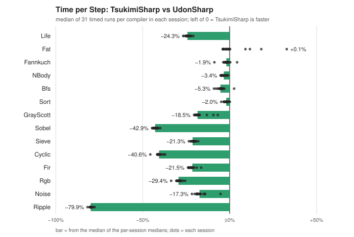
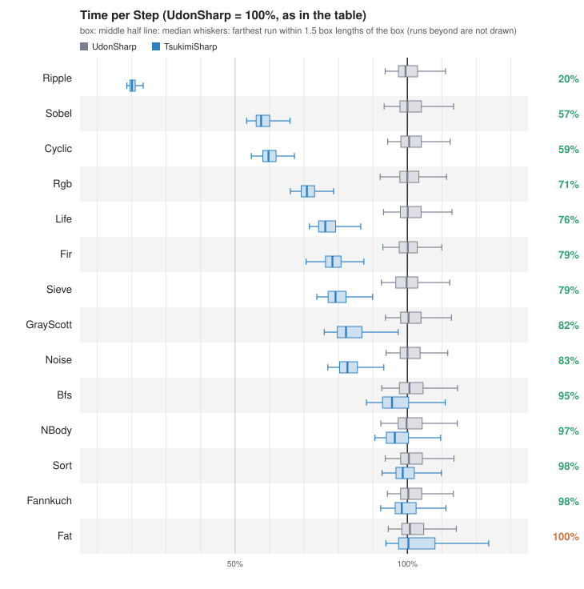
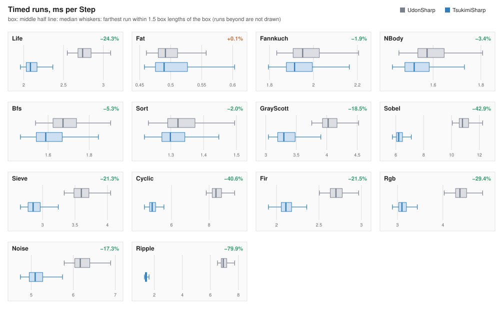

# 2026-10-25-0.10.1

[日本語](README.ja.md)

20 sessions (`result-20261025-021716.json`, `result-20261025-021915.json`, `result-20261025-022116.json`, `result-20261025-022314.json`, `result-20261025-022508.json`, `result-20261025-022701.json`, `result-20261025-022852.json`, `result-20261025-023046.json`, `result-20261025-023239.json`, `result-20261025-023430.json`, `result-20261025-023624.json`, `result-20261025-023820.json`, `result-20261025-024014.json`, `result-20261025-024208.json`, `result-20261025-024402.json`, `result-20261025-024557.json`, `result-20261025-024752.json`, `result-20261025-024948.json`, `result-20261025-025142.json`, `result-20261025-025337.json`), each timing its benchmarks 31 times per compiler. Difference = (TsukimiSharp − UdonSharp) / UdonSharp of the time per Step, using the median of the timed runs (with several sessions, the median of the per-session medians; with two sessions, their mean).

Notes on this measurement (environment, versions): [notes.md](notes.md)

## Environment

- Unity 2022.3.22f1  com.vrchat.worlds 3.10.4  com.tsukimicode.udon-tools 0.10.1  CPU AMD Ryzen 5 7600X 6-Core Processor  (12 threads)  RAM 64675 MB  OS Windows 11  (10.0.26200) 64bit

## Results

| Benchmark | UdonSharp ms/Step | TsukimiSharp ms/Step | Difference |
|:--|--:|--:|--:|
| Life | 2.737 | 2.072 | −24.3% |
| Fat | 0.488 | 0.488 | +0.1% |
| Fannkuch | 1.946 | 1.909 | −1.9% |
| NBody | 1.578 | 1.526 | −3.4% |
| Bfs | 1.663 | 1.574 | −5.3% |
| Sort | 1.316 | 1.291 | −2.0% |
| GrayScott | 4.009 | 3.268 | −18.5% |
| Sobel | 10.787 | 6.161 | −42.9% |
| Sieve | 3.606 | 2.837 | −21.3% |
| Cyclic | 8.325 | 4.943 | −40.6% |
| Fir | 2.697 | 2.118 | −21.5% |
| Rgb | 4.375 | 3.088 | −29.4% |
| Noise | 6.165 | 5.097 | −17.3% |
| Ripple | 6.959 | 1.397 | −79.9% |

## Charts

### Difference

For each benchmark, how much less time a Step takes with TsukimiSharp than with UdonSharp. A bar left of 0 (green) means TsukimiSharp is faster; right of 0 (orange), slower; grey means the difference rounds to ±0.0%. The bar is computed from the median of the per-session medians; each black dot is one session. Dots close to the bar mean the sessions agree.

### Box plot (all benchmarks)

The timed runs, per benchmark, for UdonSharp (grey) and TsukimiSharp (blue). The benchmarks take very different times, so the axis is scaled so that the UdonSharp time per Step of each benchmark in the table is 100%. The boxes pool the timed runs of every session: the box holds the middle half of the runs, the thick line in it is the median, and the whiskers reach the farthest run within 1.5 box lengths beyond the box. Runs beyond the whiskers are not drawn; nearly all of them are slow runs, and some of them fall in the same round for both compilers (probably the editor or the OS; not investigated). A blue box clear of the grey box and to its left means TsukimiSharp is faster by more than the noise; overlapping boxes mean the difference is about the size of the noise. The number on the right is the TsukimiSharp time in the table as a percentage of UdonSharp (100% + the difference). Rows are sorted by the difference, the largest speed-up first.

### Box plot per benchmark

The same box plots, one per benchmark, in milliseconds, for reading the actual time of a Step. The number at the top right is the difference. Each benchmark has its own axis.

Every timed run is in the `result-*.json` files.
